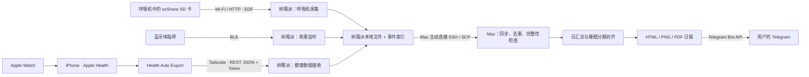
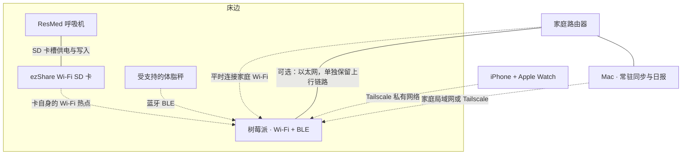

# Fitbox：家庭健康数据采集与日报

把呼吸机 SD 卡、Apple Watch 和蓝牙体脂秤的数据汇集到本地，生成中文健康日报，并通过 Telegram 发送。树莓派负责采集，Mac 负责同步、分析和出图。

本仓库是从实际运行系统整理的公开版本，使用独立配置和合成示例，不包含个人健康档案、真实设备地址、账号凭据或原项目 Git 历史。**公开源码的许可证尚待确认，目前不声明 MIT 等开源授权。**

## 能做什么

- **无线读取呼吸机数据**：ezShare Wi-Fi SD 卡留在呼吸机内，树莓派定时连接卡的热点，读取 `STR.EDF` 与 `DATALOG`，校验后保存。
- **接收手表数据**：iPhone 上的 Health Auto Export 将 Apple Health 指标及逐段睡眠 JSON 发给树莓派。
- **记录体重**：监听受支持体脂秤的蓝牙广播，在称重时读取体重与阻抗；当前协议针对 `AFU-BH-TZ-B1`，并非通用蓝牙秤驱动。
- **对齐睡眠数据**：把手表估计的深睡、快速眼动、核心睡眠、清醒时间段，与呼吸机实测呼吸频率、漏气及使用时段对齐。
- **发送日报**：暗色 HTML / PNG / PDF 报告，包含指标、趋势、睡眠分期对照和训练记录。数据迟到时按发送状态补发，避免每次同步重复发送。

## 日报示例

以下图片全部使用虚构数据，可运行 `python3 examples/render_demo.py` 重新生成；不会发送 Telegram。


## 系统架构



## 硬件连接图



SD 卡始终插在呼吸机内，**没有 USB 读卡器到树莓派的连接**。只有一块 Wi-Fi 网卡时，树莓派访问卡热点会暂时离开家庭 Wi-Fi，SSH / Tailscale 因此可能中断。采集程序和独立恢复任务负责切回家庭网络。接入以太网可保留独立上行链路，但仍需正确配置路由。

## 快速开始

先在独立目录试用，避免把示例配置覆盖到已有运行环境。

```bash
python3 --version  # 需要 Python 3.12 或更新版本
python3 -m venv .venv
source .venv/bin/activate
pip install -r requirements.txt
python3 scripts/init_local.py
python3 examples/render_demo.py
```

初始化后按提示编辑本地配置。合成示例不需要真实健康数据；图片与 PDF 渲染需要 Google Chrome / Chromium。可以用 `CHROME_BIN` 指定浏览器路径。

开始真实采集前阅读 [部署说明](docs/deployment.md)，完成树莓派依赖、SSH、Tailscale、网络连接配置和 Telegram 设置。主要配置包括：

| 配置 | 用途 |
|---|---|
| `FITBOX_HOSTS`、`FITBOX_SSH_USER` | Mac 访问树莓派的主机列表及 SSH 用户 |
| `FITBOX_DATA_ROOT` | 本地私有数据根目录 |
| `FITBOX_TIMEZONE` | 睡眠与呼吸机对齐所用时区 |
| `FITBOX_HEIGHT_CM`、`FITBOX_AGE`、`FITBOX_SEX` | 体成分估算参数，填写使用者自己的值 |
| `CHROME_BIN` | Chrome / Chromium 可执行文件 |
| `TELEGRAM_BOT_TOKEN`、`TELEGRAM_CHAT_ID` | 报告发送目标与凭据 |

### Health Auto Export 设置

建议保留两条 JSON 导出自动化，发送到相同接收端：

1. **每日汇总**：提供整晚起止时间、各阶段总量及其他健康指标。
2. **睡眠逐段明细**：选择 Sleep Analysis，关闭 “Summarize Data / 汇总”，保留每段的开始、结束与阶段。

接收端需要 `X-Fit-Token` 请求头。JSON 明细与汇总分别使用，不让逐段记录覆盖每日总量。只有汇总时仍可生成日报，但无法进行逐阶段呼吸机对照。iPhone 的系统后台调度会影响自动导出时间，因此不能把设定的导出时刻当作确定送达时间。

### 默认运行节奏

- 树莓派每天 **07:30** 采集，**21:30** 补漏；周末增加 **08:00、09:00**。定时任务有最多 3 分钟随机延迟，时间按树莓派本地时区。
- 当天已成功获取目标数据时，后续任务跳过，避免再次切换网络。
- Mac 接收新数据后检查日报条件；到截止时间仍缺部分数据则按现有数据发送，之后按补发状态更新。
- **Mac 必须开机、联网且同步进程正在运行，才能生成与发送日报。** Mac 离线不影响树莓派已经落盘的数据，恢复连接后可继续同步。

## 如何理解分析

- 睡眠分期来自 **Apple Watch 的估计**；呼吸频率、漏气来自 **呼吸机实测**。
- 分阶段比较是本项目按时间重叠计算的统计，**不是瑞思迈官方分期或诊断算法**。
- 漏气 P95 是 95% 时间不超过的漏气值，不是平均值。不同阶段的 P95 差异不能直接解释为漏气导致了深睡不足。
- 呼吸频率的指示参考个人历史范围；不能套用 AHI 的 `<5` 规则。
- 缺失、不完整、重叠冲突或覆盖不足的数据会被标记，不能用 0 代替“没有数据”。

实现边界与指标来源见 [架构与数据说明](docs/architecture.md) 和 [睡眠分析参考](docs/sleep-analysis.md)。

## 目录

```text
fitbox/                       采集、同步、分析、渲染及测试
skills/ezshare-cpap-read/      旧固件 ezShare 读取经验与协议说明
deploy/                       树莓派 systemd 与 Mac 常驻任务模板
docs/                         架构与部署说明
examples/                     合成数据与日报演示
scripts/                      本地初始化工具
```

验证代码：

```bash
python3 -m unittest discover -s fitbox -p 'test_*.py'
```

## 兼容范围与数据边界

目前方案来自一套 ResMed EDF + 旧固件 ezShare 的实机验证。相似产品名不代表相同 HTTP 接口，其他卡固件、呼吸机及体脂秤型号需要重新验证；旧卡具体读取方式见 [ezShare skill](skills/ezshare-cpap-read/SKILL.md)。

真实 EDF、Apple Health 导出、训练记录、日报、运行日志与凭据应留在私有数据目录，不提交 Git。Telegram 会接收实际发送的日报内容；其他原始文件默认保存在树莓派和 Mac。请勿在 issue 中直接附原始健康文件或完整运行配置。
