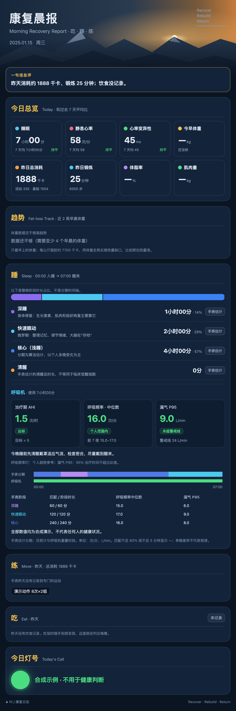
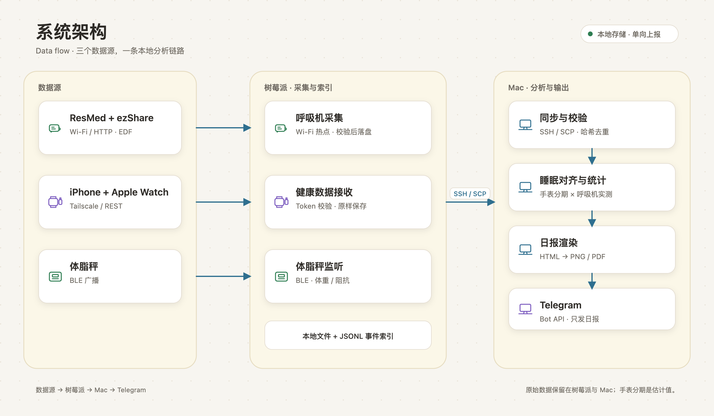
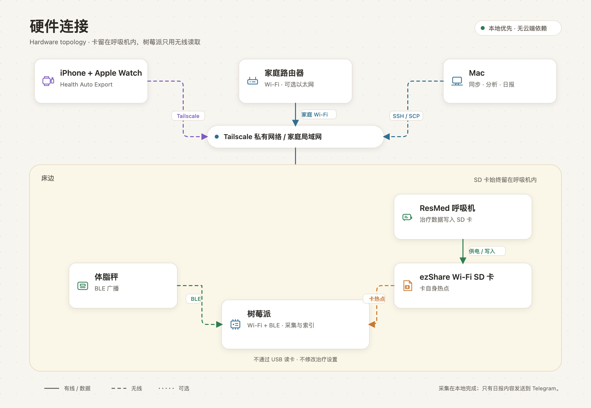

# Fitbox：家庭健康数据采集与日报

把呼吸机 SD 卡、Apple Watch 和蓝牙体脂秤的数据汇集到本地，生成中文健康日报，并通过 Telegram 发送。树莓派负责采集，Mac 负责同步、分析和出图。

本仓库是从实际运行系统整理的公开版本，使用独立配置和合成示例，不包含个人健康档案、真实设备地址、账号凭据或原项目 Git 历史。**原创代码采用 [MIT License](LICENSE)；第三方来源声明见 [THIRD_PARTY_NOTICES.md](THIRD_PARTY_NOTICES.md)。**

## 能做什么

- **无线读取呼吸机数据**：ezShare Wi-Fi SD 卡留在呼吸机内，树莓派定时连接卡的热点，读取 `STR.EDF` 与 `DATALOG`，校验后保存。
- **接收手表数据**：iPhone 上的 Health Auto Export 将 Apple Health 指标及逐段睡眠 JSON 发给树莓派。
- **记录体重**：监听受支持体脂秤的蓝牙广播，在称重时读取体重与阻抗；当前协议针对 `AFU-BH-TZ-B1`，并非通用蓝牙秤驱动。
- **对齐睡眠数据**：把手表估计的深睡、快速眼动、核心睡眠、清醒时间段，与呼吸机实测呼吸频率、漏气及使用时段对齐。
- **发送日报**：暗色 HTML / PNG / PDF 报告，包含指标、趋势、睡眠分期对照和训练记录。数据迟到时按发送状态补发，避免每次同步重复发送。

## 日报示例

以下图片全部使用虚构数据，可运行 `python3 examples/render_demo.py` 重新生成；不会发送 Telegram。



## 让 AI 代理部署

仓库里的 [docs/agent-install.md](docs/agent-install.md) 是写给 AI agent 的部署契约：分阶段命令、验证门、故障决策树和禁止事项。把下面这段和仓库地址一起发给你的 AI：

> 请阅读 https://github.com/successcw/fitbox/blob/main/docs/agent-install.md
> 按阶段为我部署 fitbox。先只做信息收集和只读预检，把需要我提供的内容列出来；我确认后再继续。不要向我索要 token 明文，不要修改呼吸机治疗参数，不要格式化 SD 卡，不要把 8787 端口暴露到公网，也不要在未验证时声称部署成功。

AI 可以完成代码安装、配置检查、服务部署和验证；但硬件接线、iPhone 上的 Health Auto Export、Telegram/Tailscale 账号和 sudo 授权必须由你完成。缺少这些条件时，它应当停下并说明缺什么，而不是猜一个结果。

也可以先手动跑一次只读预检：

```bash
python3 scripts/preflight.py --role auto
```

## 系统架构

<picture>
  <source media="(prefers-color-scheme: dark)" srcset="docs/diagrams/architecture-dark.png">
  
</picture>

<sub>图由 [`scripts/render_diagrams.py`](scripts/render_diagrams.py) 生成；GitHub 会按明暗主题选择对应版本。</sub>

## 硬件连接图

<picture>
  <source media="(prefers-color-scheme: dark)" srcset="docs/diagrams/hardware-dark.png">
  
</picture>

<sub>卡始终插在呼吸机内，树莓派不通过 USB 读卡；图中虚线表示无线或可选链路。</sub>

SD 卡始终插在呼吸机内，**没有 USB 读卡器到树莓派的连接**。只有一块 Wi-Fi 网卡时，树莓派访问卡热点会暂时离开家庭 Wi-Fi，SSH / Tailscale 因此可能中断。采集程序和独立恢复任务负责切回家庭网络。接入以太网可保留独立上行链路，但仍需正确配置路由。

## 快速开始

先在独立目录试用，避免把示例配置覆盖到已有运行环境。

```bash
python3 --version  # 需要 Python 3.12 或更新版本
python3 -m venv .venv
source .venv/bin/activate
pip install -r requirements.txt
python3 scripts/init_local.py
python3 examples/render_demo.py
```

初始化后按提示编辑本地配置。合成示例不需要真实健康数据；图片与 PDF 渲染需要 Google Chrome / Chromium。可以用 `CHROME_BIN` 指定浏览器路径。

开始真实采集前阅读 [部署说明](docs/deployment.md)，完成树莓派依赖、SSH、Tailscale、网络连接配置和 Telegram 设置。主要配置包括：

| 配置 | 用途 |
|---|---|
| `FITBOX_HOSTS`、`FITBOX_SSH_USER` | Mac 访问树莓派的主机列表及 SSH 用户 |
| `FITBOX_DATA_ROOT` | 本地私有数据根目录 |
| `FITBOX_TIMEZONE` | 睡眠与呼吸机对齐所用时区 |
| `FITBOX_HEIGHT_CM`、`FITBOX_AGE`、`FITBOX_SEX` | 体成分估算参数，填写使用者自己的值 |
| `CHROME_BIN` | Chrome / Chromium 可执行文件 |
| `TELEGRAM_BOT_TOKEN`、`TELEGRAM_CHAT_ID` | 报告发送目标与凭据 |

### Health Auto Export 设置

当前部署使用三条 JSON 自动化，发送到同一接收端，请求头设置 `X-Fit-Token`：

| 自动化 | 范围与格式 | 日报用途 |
|---|---|---|
| 健康 | 过去 7 天全部健康指标，开启汇总 | 昨天的步数、能量、活动等，以及历史趋势基线 |
| 睡眠 | 今天全部健康指标，关闭汇总 | 今天睡醒的睡眠分段、分期对照；今天 HRV、静息心率采样 |
| 锻炼 | 过去 7 天锻炼记录 | 昨天的具体锻炼项目、时长、消耗 |

昨天的健康指标以第 1 路日汇总为准，不要求昨天活动明细。第 2 路包含的其他数值明细不会覆盖已有日汇总；缺少汇总时才作为有来源标记的回填。睡眠区间及采样去重处理，锻炼按记录 ID 去重，避免重复导出累加。缺数据显示未同步，手动训练单独保留。

iPhone 后台调度会影响实际送达时间。[官方自动化说明](https://help.healthyapps.dev/en/health-auto-export/automations/rest-api/)。

### 默认运行节奏

- 树莓派每天 **07:30** 采集，**21:30** 补漏；周末增加 **08:00、09:00**。定时任务有最多 3 分钟随机延迟，时间按树莓派本地时区。
- 日常旧固件采集只扫描昨夜；历史补档用显式 `--since`。定时采集失败后先恢复家庭网络，15 秒后再试一轮，复用探测进度；两轮失败则停止切网；若家庭网络未恢复，则禁止启动第二轮并保留恢复守护。已下载 EDF 缺少配套 CRC 时，下轮会重新请求 CRC，不复用其缺失缓存。
- 当天已成功获取目标数据时，后续任务跳过，避免再次切换网络。
- Mac 接收新数据后检查日报条件；到 **08:00** 仍缺呼吸机波形则按现有数据发送（每 30 秒检查；需要已收到当晚睡眠），之后按补发状态更新。
- **Mac 必须开机、联网且同步进程正在运行，才能生成与发送日报。** Mac 离线不影响树莓派已经落盘的数据，恢复连接后可继续同步。

## Telegram 训练记录

明确完成的训练，例如“昨天打了一个半小时篮球，记录一下”，会按消息日期自动写入私有训练日志，并以消息 ID 去重；真正写入后才回复“已记”。提问、计划、否定和无法确定的复杂记录仍留在待整理队列。补记昨天训练时，已经发送的日报会按内容变化更新一次。手动时长不叠加到手表活动时长，避免重复计算。

缺少每日 HRV 汇总时，使用已同步、去重后的毫秒采样均值，显示采样数量；静息心率取最新已同步测量。官方日汇总到达后优先使用。

## 如何理解分析

- 睡眠分期来自 **Apple Watch 的估计**；呼吸频率、漏气来自 **呼吸机实测**。
- 分阶段比较是本项目按时间重叠计算的统计，**不是瑞思迈官方分期或诊断算法**。
- 漏气 P95 是 95% 时间不超过的漏气值，不是平均值。不同阶段的 P95 差异不能直接解释为漏气导致了深睡不足。
- 呼吸频率的指示参考个人历史范围；不能套用 AHI 的 `<5` 规则。
- 缺失、不完整、重叠冲突或覆盖不足的数据会被标记，不能用 0 代替“没有数据”。

实现边界与指标来源见 [架构与数据说明](docs/architecture.md) 和 [睡眠分析参考](docs/sleep-analysis.md)。

## 目录

```text
fitbox/                       采集、同步、分析、渲染及测试
skills/ezshare-cpap-read/      旧固件 ezShare 读取经验与协议说明
deploy/                       树莓派 systemd 与 Mac 常驻任务模板
docs/                         架构、部署说明、AI 代理部署手册与生成的图表
examples/                     合成数据与日报演示
scripts/                      本地初始化、预检与图表渲染工具
```

验证代码：

```bash
python3 -m unittest discover -s fitbox -p 'test_*.py'
```

## 兼容范围与数据边界

目前方案来自一套 ResMed EDF + 旧固件 ezShare 的实机验证。相似产品名不代表相同 HTTP 接口，其他卡固件、呼吸机及体脂秤型号需要重新验证；旧卡具体读取方式见 [ezShare skill](skills/ezshare-cpap-read/SKILL.md)。

真实 EDF、Apple Health 导出、训练记录、日报、运行日志与凭据应留在私有数据目录，不提交 Git。Telegram 会接收实际发送的日报内容；其他原始文件默认保存在树莓派和 Mac。请勿在 issue 中直接附原始健康文件或完整运行配置。
